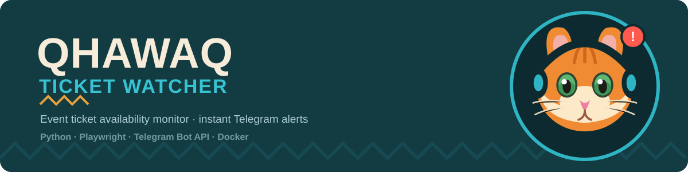
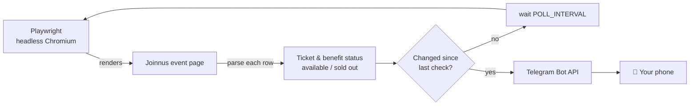

# Qhawaq — Joinnus Ticket Availability Monitor

**A lightweight bot that watches a [Joinnus](https://www.joinnus.com) event page and sends you an instant Telegram alert the moment a ticket tier or fan-meeting add-on changes state — restocked, newly released, or sold out — so you can buy through the normal flow before everyone else.**

*Personal project · Python + Playwright + Telegram · named after **Qhawaq**, "the watcher" in Quechua.*


---

## Table of contents

1. [Overview](#1-overview)
2. [Tech stack](#2-tech-stack)
3. [How it works](#3-how-it-works)
4. [Features](#4-features)
5. [Project structure](#5-project-structure)
6. [Getting started (local)](#6-getting-started-local)
7. [Configuration](#7-configuration)
8. [Deploy 24/7](#8-deploy-247)
9. [Responsible use](#9-responsible-use)
10. [License](#10-license)

---

## 1. Overview

Ticket tiers and special fan-meeting benefits (a 1:1 photo, a signed photocard, a polaroid) for popular concerts tend to sell out in seconds and get restocked without warning. Refreshing the page by hand is a losing game.

**Qhawaq** solves that: it keeps an eye on the event page for you and pings your phone through Telegram the instant something you care about becomes available, with a direct link to buy. You still complete the purchase yourself, the normal way.

The interesting engineering detail is that Joinnus renders its ticket list in server-side HTML **and** blocks naive HTTP clients (a plain `requests.get` is refused by bot protection). The monitor therefore drives a **real headless browser** to render and read the page exactly as a human visitor would.

---

## 2. Tech stack

| Layer            | Technology                              | Why                                                               |
| ---------------- | --------------------------------------- | ----------------------------------------------------------------- |
| Language         | **Python 3.12**                         | Fast to write, great library support                              |
| Browser control  | **Playwright** (headless Chromium)      | Renders JS and passes the site's basic bot protection             |
| Notifications    | **Telegram Bot API** (via `requests`)   | Free, instant push to the phone, trivial to set up                |
| Config / secrets | **python-dotenv** + environment vars    | Credentials stay out of the codebase                              |
| Packaging        | **Docker**                              | One reproducible image, browser included                          |
| Hosting          | **Railway** (any Docker host works)     | Runs the monitor 24/7 without a local machine                     |

---

## 3. How it works



1. A headless Chromium instance loads the event page every `POLL_INTERVAL` seconds.
2. The text of each row is parsed into a `{name: available | sold_out}` map (a row shows a quantity selector when available, or `AGOTADAS` when sold out).
3. The new snapshot is compared to the previous one.
4. If anything flipped to **available**, a **new tier** appeared, or something **sold out**, a formatted Telegram message is sent with the buy link.

Polling is jittered and kept at a gentle interval so the site is never hammered.

---

## 4. Features

- 🔔 **Instant Telegram alerts** with a direct purchase link.
- 🎟️ **Per-tier tracking** — every ticket tier and add-on benefit is tracked by name and state.
- ♻️ **Restock detection** — the main use case: tells you when a sold-out benefit frees up.
- 🆕 **New-tier & sold-out detection** — surfaces newly published tiers and items that just sold out.
- 🛡️ **Bot-protection aware** — uses a real browser instead of a blocked HTTP request.
- 🔐 **Secrets via environment variables** — nothing sensitive in the code.
- 🐳 **Docker-ready** — deploy anywhere, run 24/7.

---

## 5. Project structure

```
qhawaq-ticket-watcher/
├─ watcher.py             ← the watcher (parse + compare + notify loop)
├─ requirements.txt       ← Python dependencies
├─ Dockerfile             ← builds Python + Chromium image
├─ .env.example           ← template for configuration / secrets
├─ .gitignore             ← keeps .env and caches out of git
├─ LICENSE                ← MIT
└─ README.md              ← you are here
```

---

## 6. Getting started (local)

**Requirements:** Python 3.12+

```bash
# 1. Install dependencies
pip install -r requirements.txt

# 2. Install the Chromium browser Playwright drives
playwright install chromium

# 3. Configure your credentials
cp .env.example .env      # then edit .env with your values

# 4. Run
python watcher.py
```

If everything is set up, a **"Monitor is live"** message with the current ticket states arrives in your Telegram, and the console prints a check every `POLL_INTERVAL` seconds.

### Getting the Telegram credentials

1. Create a bot with [@BotFather](https://t.me/BotFather) → `/newbot` → copy the **token**.
2. Send any message to your new bot (required before it can message you).
3. Get your **chat id** from [@userinfobot](https://t.me/userinfobot), or open
   `https://api.telegram.org/bot<TOKEN>/getUpdates` and read `chat.id`.

---

## 7. Configuration

All configuration is read from environment variables (or a local `.env` file):

| Variable           | Required | Default            | Description                                      |
| ------------------ | -------- | ------------------ | ------------------------------------------------ |
| `TELEGRAM_TOKEN`   | ✅        | —                  | Bot token from @BotFather                        |
| `TELEGRAM_CHAT_ID` | ✅        | —                  | Your Telegram chat id                            |
| `EVENT_URL`        | ✅        | sample event       | The Joinnus event page to watch                  |
| `POLL_INTERVAL`    | ❌        | `120`              | Seconds between checks                            |
| `HEADLESS`         | ❌        | `true`             | `false` shows the browser window (debugging)     |

---

## 8. Deploy 24/7

To keep watching when your computer is off, run it on any Docker host. Example with **Railway**:

1. Push this repository to GitHub.
2. On [Railway](https://railway.app): **New Project → Deploy from GitHub repo** and select it.
3. Railway detects the `Dockerfile` and builds the image (Python + Chromium) automatically.
4. Add the environment variables from [§7](#7-configuration) under the service's **Variables** tab.
5. Check the **Logs** — you should see the startup state and a `telegram 200` line. The monitor now runs around the clock.

> Any Docker-capable platform works (Fly.io, Render, a VPS, a Raspberry Pi). Only the hosting step changes.

---

## 9. Responsible use

Qhawaq is a **personal availability notifier**. It only reads a public page and tells its owner when to buy. By design it does **not**:

- bypass virtual queues or waiting rooms,
- solve CAPTCHAs or any anti-bot challenge,
- automate checkout, payment, or bulk/scalping purchases.

The actual purchase is always made by a human, through the official flow, in normal quantities. Requests are jittered and rate-limited to be gentle on the site. Please respect Joinnus's Terms of Service.

---

## 10. License

Released under the [MIT License](LICENSE). © 2026 \<Isabel Makishi\>.
